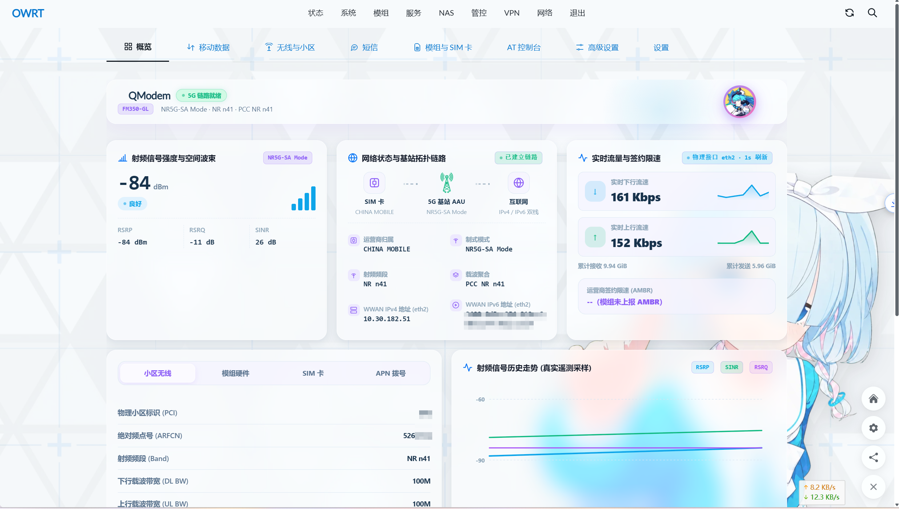

<div align="center">

# 🚀 luci-app-qmodem-generic

**QModem 通用美化版 LuCI WebUI · 现代化、全模组解耦的蜂窝网络控制中心**

[](CHANGELOG.md)
[](https://github.com/LianXia233/luci-app-qmodem-generic/actions/workflows/build.yml)
[](https://openwrt.org/)
[-8b5cf6?style=flat-square)](#-运行环境与依赖)
[](docs/QMODEM_OFFICIAL_WIRING.md)
[](LICENSE)

<p align="center">
  <b>直连 QModem 官方 ubus 接口 · 彻底解耦私有后端 · 动态字段自适应 · 1s 真实物理网卡速率 · 分天流量离线持久化</b><br>
  内置智能模组支持库自动注入 · QM UI v2 现代自适应设计系统 · 完美支持深浅色模式与移动端自适应
</p>

</div>

---

> [!NOTE]
> **💡 项目定位与架构演进**
>
> 本项目是 **QModem 的通用美化版 LuCI Web UI**。界面数据**全部直连 QModem 官方 ubus 接口**（`qmodem` / `qmodem.sms` / `qmodem.uplink`），与官方 `luci-app-qmodem-next` 保持完全同源的接线标准，**不绑定任何专有模组型号** —— QModem 识别到什么模组、上报什么字段，界面即自适应呈现什么。
>
> 本项目由 [FAN789/luci-app-mt5700m](https://github.com/FAN789/luci-app-mt5700m)（鼎桥 MT5700M 专用界面）重构演进而来，彻底剥离了历史遗留的私有文本后端与专有守护进程，转型为全模组通用、纯净现代的纯前端控制台。

---

## 📸 界面预览

<div align="center">
  
  <p><sub>图 1：总览页看板（实机真数渲染：1s 物理网卡实时速率、真实邻区与遥测曲线，敏感字段已由使用者脱敏）</sub></p>
</div>

- **双阶段秒开渲染**：首屏优先挂载骨架并立即可视，背景异步并发加载射频、链路与小区数据，页面切换零卡顿；
- **自适应动态字段**：未上报或不可测字段自动降级显示为「`--`」，不伪造平滑曲线；
- **智能 AT 终端**：常用调试指令按语义折叠分组，高危写入操作带醒目标识，支持键盘 Enter 发送、历史记录回溯与响应状态高亮；
- **现代会话式短信**：自动侦测数据库模式与模组存储，支持长短信智能重组，移动端输入框常驻贴底，视口全贴合。

---

## 🌟 核心特性亮点

| 特性维度 | 说明与优势 |
|:---|:---|
| 🔌 **直连官方 ubus 接口** | 彻底抛弃私有中间件与任务队列，数据流与控制动作 100% 直连 `qmodem`、`qmodem.sms`、`qmodem.uplink`，享受官方 rpcd 10 秒内存缓存机制，杜绝击穿 AT 串口。 |
| 🌐 **全模组通用与动态降级** | 不绑定特定硬件，广和通（FM350/FM160）、移远（RG520N/RG500Q/RM500Q）、鼎桥（MT5700）等均可即插即用；多模组设备顶部自动激活模组切换器，选择本地持久化。 |
| 📊 **物理网卡 1s 真实速率** | 直读 Linux 内核网络设备计数器增量（`netifd` / `sysfs`），每秒高精计算物理吞吐，搭配 10 秒实时遥测走势图与真实物理小区邻区表。 |
| 💾 **90 天分天流量持久化** | 自带轻量 procd 后台采样服务（开机自启，每 60 秒一次），落盘于 overlay 分区，重启不丢记录；基于中国时区（UTC+8）自动切日，具备上下行方向智能识别与自纠偏。 |
| 💉 **模组支持库智能注入** | 自动向 QModem 注入未收录的模组定义（如移远 RG520N-CN、RG502Q-EA、RG650E-EU、RG650V-EU 等），开机与安装幂等合并，具备备份回滚与 JSON 格式安全校验。 |
| 🎨 **QM UI v2 现代自适应设计** | 颜色全令牌化（`--qm-*`），自动探测 LuCI 主题明暗并注入 `qm-dark`；移动端全宽 Modal Bottom Sheet、拖拽把手与触控优化，完美兼容 Argon、Design 等主流主题。 |

---

## 🎛️ 8 大核心功能视图矩阵

| 业务视图 | 访问路径 | 核心能力说明 |
|:---|:---|:---|
| 📊 **总览 Overview** | `admin/modem/overview` | 模组实际型号、网络制式角标、信号质量卡片；**物理网卡 1s 差值实时速率**、10s 动态遥测折线图、真实邻区表、AMBR 签约速率；双阶段异步渲染。 |
| 📶 **移动数据 Mobile Data** | `admin/modem/data` | APN 接入点设定、承载拨号状态、IPv4/IPv6 双栈网络详情与连接会话统计。 |
| 📡 **射频与小区 Radio & Cells** | `admin/modem/cells` | 频段详情（带 `NR n41` / `LTE B41` 等规范制式前缀）、服务小区与邻区物理参数、一键锁频段 / 锁物理小区（PCI）、射频链路诊断。 |
| 💬 **短信中心 Messages** | `admin/modem/sms` | 数据库模式与传统模组存储自动适配；完整会话视图、未读状态标记；会话高度贴合视口，移动端输入框常驻贴底，支持长短信重组。 |
| ⚙️ **模组与 SIM** | `admin/modem/system` | 模组硬件身份（IMEI/IMSI/ICCID）、SIM 卡状态与卡槽切换；设备一键软硬件复位重启。 |
| 🛠️ **高级设置 Advanced** | `admin/modem/advanced` | QM UI 外观主题自由切换、USB/PCIe 串口与模组拓扑映射、自定义型号定义注入、支持库状态同步及底层能力诊断。 |
| 💻 **AT 调试终端** | 从高级页入口跳转 | 经 `qmodem` ubus 下发 AT 命令；官方快捷指令按语义折叠分组（危险写入操作特殊标红），按钮双行展示语义与原语，支持键盘 Enter 快捷发送。 |
| 🔧 **设备参数设置** | 从高级/模组页跳转 | QModem `modem-device` UCI 配置节原生可视化调优（拨号协议、初始化指令、APN 等）。 |

---

## 🚀 安装与部署

### 1. 运行环境与依赖兼容性

| 运行环境 | 安装包格式 | 兼容状态 | 说明 |
|:---|:---:|:---:|:---|
| **ImmortalWrt 25.12+ / snapshot** | `.apk` | ✅ **全面支持** | 新一代 apk 包管理器，支持原生离线 `.run` 安装 |
| **OpenWrt / ImmortalWrt 24.10** | `.ipk` | ✅ **全面支持** | 当前长期维护主力系统 |
| **OpenWrt / iStoreOS 23.05** | `.ipk` | ✅ **全面支持** | 支持 JavaScript LuCI 基础架构的固件 |

> **前置依赖**：`luci-base`、[`qmodem`](https://github.com/FUjr/QModem)、`jq`、`jsonfilter`。  
> 本软件包架构为 **`all`**（纯 JavaScript 前端 + Shell 后端脚本），通用适配 x86_64、ARMv8、MediaTek Filogic、MIPS 等各类硬件架构。

### 2. 快捷安装命令

前往 [GitHub Releases](https://github.com/LianXia233/luci-app-qmodem-generic/releases) 下载最新发行版：

```sh
# -------------------------------------------------------------
# 【方式 A：iStore / 离线 RUN 安装（推荐，无网络环境下首选）】
# -------------------------------------------------------------
# apk 系统（ImmortalWrt 25.12+）
sh ./luci-app-qmodem-generic-*-apk-offline.run

# opkg 系统（OpenWrt 23.05 / 24.10 / iStoreOS）
sh ./luci-app-qmodem-generic_*-ipk-offline.run

# -------------------------------------------------------------
# 【方式 B：SSH 终端包管理器直接安装】
# -------------------------------------------------------------
# apk 系统
apk --no-network --repositories-file /dev/null add --allow-untrusted \
  ./luci-app-qmodem-generic-*.apk \
  ./luci-i18n-qmodem-generic-zh-cn-*.apk

# opkg 系统（主包与中文语言包联合安装）
opkg install \
  ./luci-app-qmodem-generic_*_all.ipk \
  ./luci-i18n-qmodem-generic-zh-cn_*_all.ipk
```

> [!WARNING]
> **旧版清理提醒**：若路由器此前安装过旧版专有插件（如 `luci-app-mt5700m`），建议先执行 `opkg remove luci-app-mt5700m`，避免旧残留的菜单配置与 ACL 权限规则造成干扰。

安装完成后，刷新浏览器进入 LuCI 侧边栏：**移动网络** → **模组管理** 即可开始使用。

---

## 📈 流量统计服务机制

总览页的「流量统计」卡片由本包内置的后台守护进程驱动，具有高可靠性：

```text
  [物理网卡计数器] ──> [/usr/bin/qmodem-stats-collect] (每 60 秒轮询)
                                 │
                                 ▼
                     [/etc/qmodem-stats/YYYY-MM-DD.json] (持久化 90 天)
                                 │
                                 ▼
                     [rpcd: qmodem_stats] ──> [WebUI 渲染展示]
```

- **全模组通用采集**：优先调用 QModem `get_stats`，未实现时自动平滑回退至 Linux 内核 netdev 物理网卡计数器；
- **时区与日期切分**：按中国标准时区（UTC+8）由 `epoch + 28800` 运算切日，不受系统复杂夏令时影响；
- **上下行方向反转自愈**：累计流量超过 50MB 且检测到 `tx > rx` 异常时，前端自动智能交换上下行展示；
- **重拨与回绕处理**：接口重连或计数器溢出回绕时，自动重置基线重新累加，绝不产生异常天文数字。

---

## 💉 模组支持库自动注入机制

QModem 依赖 `/usr/share/qmodem/modem_support.json` 建立模组与硬件的识别链路。对于部分官方未收录的型号（例如 Quectel RG520N-CN 等），本插件内置自动注入引擎：

| 执行时机 | 执行逻辑与安全防御 |
|:---|:---|
| **首次安装** | 通过 `/etc/uci-defaults` 钩子立即触发注入合并 |
| **开机自启** | 通过 `/etc/init.d/qmodem-modem-support`（`START=90` 早于 QModem）幂等复核 |
| **手动同步** | 在 WebUI **高级 → 模组支持库** 点击「同步支持库」或执行 `/usr/sbin/qmodem-modem-support` |
| **安全性保证** | ① **幂等安全**：已存在的型号自动跳过；<br>② **自动备份**：首次修改前自动生成 `.json.bak`；<br>③ **格式强校验**：写入后必须通过 JSON 语法检验，失败立即回滚还原。 |

---

## 🛠️ 自行编译与源码集成

可将本仓库直接作为 feed 引入 OpenWrt / ImmortalWrt 固件源码编译体系：

```sh
# 1. 添加软件源 feed
echo 'src-git qmodem_generic https://github.com/LianXia233/luci-app-qmodem-generic.git' >> feeds.conf.default

# 2. 更新并安装包
./scripts/feeds update qmodem_generic
./scripts/feeds install -a -p qmodem_generic

# 3. 勾选配置
make menuconfig   # 定位到: LuCI -> Applications -> luci-app-qmodem-generic

# 4. 单独编译本包
make package/luci-app-qmodem-generic/compile V=s
```

### GitHub Actions 自动化构建

仓库内置 [`.github/workflows/build.yml`](.github/workflows/build.yml) 流水线，可在 GitHub 仓库页面一键手动触发（`workflow_dispatch`）：
- **Lint 门禁**：对 JS 语法（`node --check`）、JSON 解析、Gettext PO 翻译文件及 ACL 权限列表进行秒级静态检查；
- **多 SDK 构建**：并行使用 ImmortalWrt 25.12 SDK 构建 `.apk`、24.10 SDK 构建 `.ipk`，并封装独立离线 `.run` 安装包；
- **发布自动化**：构建成功后自动汇聚附件并发布至 Releases。

---

## 🎨 QM UI v2 设计系统与主题

插件视觉层由 `htdocs/luci-static/resources/qmodem-generic/theme.js` 统一接管：

- **明暗与底色跟随**：探针探测当前 LuCI 主题的背景明度，自动向 `body` 挂载 `qm-dark` 类；主色支持跟随系统、清爽蓝、暮光紫与蓝绿渐变自由切换；
- **全断点响应式适配**：内置 1280 / 1024 / 820 / 560 多重断点；窄屏下自动将双栏表单切为上下堆叠，表格支持平滑横向拖拽；
- **微动效与贴底弹窗**：移动端弹窗统一采用 Modal Bottom Sheet 设计，支持拖拽把手与安全区避让，模组忙碌时重度 AT 查询异步化，杜绝界面假死。

---

## 📂 项目结构全景

```text
luci-app-qmodem-generic/
├── .github/workflows/          # GitHub Actions 自动化构建
├── docs/                       # 技术选型、接线规范与审查报告
│   ├── screenshots/            # 界面展示截图
│   ├── QMODEM_OFFICIAL_WIRING.md # 官方 ubus 接口映射详单
│   └── QMODEM_UI_THEME.md      # QM UI v2 样式与设计系统规范
├── luci-app-qmodem-generic/
│   ├── Makefile                # 顶层 OpenWrt 软件包 Makefile
│   ├── htdocs/luci-static/resources/qmodem-generic/ # 前端 UI 核心 (JS/CSS/SVG)
│   ├── po/zh_Hans/             # 中文国际化语言文件 (.po)
│   ├── root/                   # 目标系统运行环境镜像
│   │   ├── etc/init.d/         # 流量采样与支持库开机自愈服务
│   │   ├── etc/uci-defaults/   # 首次安装环境初始化与清理
│   │   ├── usr/bin/            # 流量采集核心进程
│   │   ├── usr/sbin/           # 模组定义注入与安全合并工具
│   │   └── usr/libexec/rpcd/   # 流量与支持库专用 rpcd 插件
│   └── tests/                  # 前端单元测试与 PO 词条校验
└── scripts/                    # 离线 .run 安装包封装脚本
```

---

## 💖 致敬与鸣谢

* 👤 **[FAN789/luci-app-mt5700m](https://github.com/FAN789/luci-app-mt5700m)** — 本项目的前身与架构基石
* 👤 **[FUjr/QModem](https://github.com/FUjr/QModem)** — 优秀的模组后端引擎与 `luci-app-qmodem-next` 接口参考
* 🐧 **[ImmortalWrt](https://github.com/immortalwrt/immortalwrt)** — 优质的 SDK 编译与软件支持生态

---

> 📜 **开源许可**：本项目基于 [Apache License 2.0](LICENSE) 协议开源。
